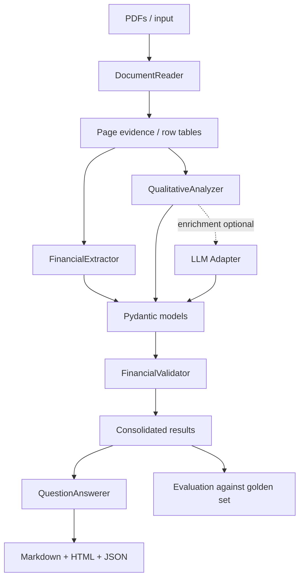
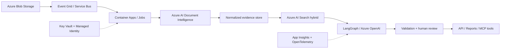

# Intra Financial AI

**Inteligência de documentos financeiros com evidência verificável, extração estruturada, validação determinística e relatório consolidado.**

Implementação do teste de engenharia de IA para o cliente Intra, por intermédio da Spread. Esta entrega prioriza **rastreabilidade, abstinência quando o dado não existe, consistência numérica e simplicidade de execução**. O problema é tratado como um fluxo governado, não como um chat que recebe PDFs inteiros.

## 1. O desafio e o que foi entregue

O enunciado requer ingestão de texto/tabelas, JSON por documento com página e trecho, interpretação de riscos e resultados, cinco perguntas, verificações de margem/variação/unidade, relatório comparativo e discussão de arquitetura/custo/segurança/Azure.

| Requisito | Implementação | Limite conhecido |
|---|---|---|
| Ingestão PDF | PyMuPDF, seleção de leitura por layout, SHA-256 por documento e extração de linhas financeiras | Sem OCR para páginas escaneadas |
| Tabelas | Identificação de linhas financeiras por posição, além de método de extração tabular via pdfplumber | Nem toda grade/tabela irregular vira células completas |
| JSON auditável | Pydantic, status `found/not_found/conflict/invalid`, fonte e página | Campo ausente permanece ausente |
| Números | Mapeamento de valores monetários para `BRL million`, ano/escopo explícitos | Não deriva EBITDA não divulgado |
| Análise qualitativa | Regras com evidência + enriquecimento opcional por LLM com verificação de citação | Fallback pode não recuperar todas as nuances |
| Orquestração | LangGraph quando instalado; fallback sequencial idêntico para execução mínima offline | Sem estado persistido entre execuções |
| Validação | Python determinístico para citações, unidades, anos, variações e conflitos | Não substitui auditoria contábil |
| Perguntas | Cinco respostas automáticas citadas, com abstinência quando faltam indicadores | Ranking impossível sem base homogênea |
| Relatórios | JSON por empresa, Markdown, HTML, questões, manifesto e métricas | HTML não é aplicação web |
| Avaliação | `evals/golden_dataset.json` e comparador com tolerância | Amostra reduzida a documentos do desafio |
| Segurança | Limites PDF, verificação de tipo, sem execução de conteúdo, API key fora do Git | Não implementa OAuth, IAM ou isolamento multi-tenant |

## 2. Instalação e execução

Recomendo **Python 3.12**, terminal PowerShell, Git e ambiente virtual. Os três PDFs estão em `data/input/`.

### Windows PowerShell

```powershell
py -3.12 -m venv .venv
.\.venv\Scripts\Activate.ps1
python -m pip install -e ".[quality,agentic]"
python -m intra_financial_ai analyze data/input --output outputs
```

Se precisar executar sem instalar LangGraph nem provedor de LLM, instale apenas o core e qualidade:

```powershell
python -m pip install -e ".[quality]"
python -m intra_financial_ai analyze data/input --output outputs
```

Nesse caso o manifesto registra `sequential_fallback` e o mesmo pipeline determinístico é executado. Para obter o **modo LangGraph efetivo**, instale `.[agentic]` com acesso ao índice de pacotes Python.

### Linux / macOS

```bash
python3 -m venv .venv
source .venv/bin/activate
python -m pip install -e '.[quality,agentic]'
intra-ai analyze data/input --output outputs
```

### Testes e avaliação

```bash
python -m pytest -q
python -m intra_financial_ai evaluate outputs/run_SEU_ID --golden evals/golden_dataset.json
```

O último comando salva `evaluation.json` dentro do diretório da execução. Substitua `run_SEU_ID` pelo nome mostrado no terminal.

### Enriquecimento qualitativo com LLM

Use o `.env.example` como referência. Defina as variáveis no ambiente do terminal ou coloque-as em arquivo privado e carregue-as no shell. Exemplo no PowerShell:

```powershell
$env:INTRA_OPENAI_API_KEY="SUA_CHAVE_LOCAL"
$env:INTRA_OPENAI_MODEL="gpt-4o-mini"
python -m intra_financial_ai analyze data/input --output outputs --llm
```

**A chave não deve aparecer no código, no README alterado, nos testes, em logs, no Git nem na apresentação.** A inferência via LLM é opcional. No modo habilitado, um extrator financeiro propõe valores de páginas candidatas e um analista qualitativo propõe achados; apenas propostas com página, escopo consolidado e citação textual exata verificada podem preencher lacunas. A extração numérica primária foi mantida determinística por escolha técnica para este conjunto documental. Se a chamada externa falhar, a análise quantitativa permanece e o fallback qualitativo é acompanhado de alerta.

### Docker

```bash
docker build -t intra-financial-ai .
docker run --rm -v "$(pwd)/outputs:/app/outputs" intra-financial-ai
```

A imagem padrão executa o pipeline determinístico. Para o LangGraph no container, modifique a camada de instalação para `pip install '.[agentic]'` e reconstrua. Não envie imagens com credenciais.

## 3. Arquitetura



O `AnalysisWorkflow` monta o pipeline `ingest → extract → qualitative → validate → answer`. Se `langgraph` estiver instalado, usa um `StateGraph` explicitamente tipado. Caso contrário, executa exatamente as mesmas funções em sequência. O estado guarda resultados e tempos; prompts e infraestrutura são externos ao estado.

### Estrutura

```text
src/intra_financial_ai/
  domain/models.py                  Pydantic e contratos
  infrastructure/pdf_reader.py     Parsing de PDF e tabelas financeiras
  infrastructure/llm.py            Enriquecimento qualitativo opcional
  infrastructure/llm_financial.py  Extração financeira LLM opcional e verificações
  application/evidence.py          Evidência e normalização
  application/extraction.py        Métricas quantitativas
  application/qualitative.py       Achados qualitativos
  application/validation.py        Verificações determinísticas
  application/questions.py         Perguntas obrigatórias
  application/reporting.py         Report MD + HTML
  application/evaluation.py        Golden set e métricas
  application/workflow.py          Orquestração / LangGraph
  cli.py                            CLI
```

A saída possui `light.json`, `brasal.json`, `millet.json`, `questions.json`, `validation.json`, `metrics.json`, `manifest.json`, `evidence.jsonl`, `report.md` e `report.html`. A saída de avaliação também recebe `evaluation.json`.

## 4. Evidência, tipagem e abstenção

Cada dado reportado referencia o **número físico da página do PDF**, não a paginação impressa que pode ser diferente. O objeto `Metric` transporta `status`, `value`, `unit`, `year`, `comparator`, `scope`, `definition` e a lista `evidence`.

Um valor só pode ser marcado como `found` na extração determinística se existir uma linha ou frase que o suporte. A validação verifica, adicionalmente, que o trecho citado realmente ocorre na página indicada. Evidência e valor são separados para permitir auditar um número, não apenas confiar na resposta textual.

`not_found` **não é zero**. `conflict` preserva divergências sem adivinhá-las. `invalid` está reservado para problemas de contrato ou evidência. Cálculos de controle, como variações, não substituem valores originalmente reportados. Numeração monetária original em **milhares de reais** é dividida por 1.000 para a apresentação em **milhões**.

## 5. Decisões baseadas nos três PDFs

Os documentos fornecidos são **demonstrações anuais referentes a 2022**, não releases trimestrais. A diferença faz parte do teste e precisa ser mencionada na apresentação.

- **Light:** o texto da administração reporta receita líquida de **R$ 12.107 milhões excluindo construção** (PDF p. 9), EBITDA CVM de **R$ 1.180 milhões** (p. 9), prejuízo aproximado de **R$ 5.673 milhões** (p. 10), dívida líquida de **R$ 9.032 milhões** (p. 10) e investimentos de **R$ 1.506 milhões** (p. 10). O fluxo operacional de **R$ 200,763 milhões** vem da nota em milhares (p. 25). A frase de alavancagem da página 10 atribui **3,32x** e **3,48x** a 2021. Não foi assumido silenciosamente que um desses valores é 2022.
- **Brasal:** a DRE consolidada na página 8 contém receita líquida de **R$ 1.325,059 milhões** e lucro líquido de **R$ 174,602 milhões**. O fluxo operacional da página 11 é **R$ 258,248 milhões**. EBITDA e alavancagem não estão explicitamente reportados como indicadores, logo não foram inventados.
- **Millet:** a DRE consolidada da página 7 informa receita líquida de **R$ 462,127 milhões** e lucro líquido de **R$ 18,891 milhões** antes da atribuição aos não controladores. A linha subsequente exibe o resultado atribuível à controladora de R$ 14,743 milhões; o comparador não mistura as bases. Fluxo operacional da página 10 de **R$ 24,799 milhões**. Não inventamos EBITDA nem alavancagem.

**Atenção ao EBITDA:** o indicador CVM do Grupo Light não é igual ao EBITDA ajustado para covenants. Da mesma maneira, a receita sem construção não necessariamente é comparável à receita total consolidada de outras empresas. A margem aritmética é apenas diagnóstico, não foi publicada como margem comparável no JSON. Por isso a resposta à pergunta de maior margem explicita a insuficiência de base, em vez de inventar vencedor.

### Pergunta versus evidência

Perguntas quantitativas consultam os indicadores estruturados e seus status. Perguntas qualitativas consultam os achados com fontes. Não existe retorno gerado apenas por semelhança semântica quando a evidência não permite conclusão. Isso é deliberado para priorizar confiabilidade em ambiente financeiro.

## 6. Validação automática

1. `CITATION_NOT_VERIFIED`: a evidência não pode ser reencontrada na página do PDF.
2. `INVALID_UNIT`, `INVALID_PERIOD`: metadados inconsistentes.
3. `VARIATION_MISMATCH`: comparação matemática diverge do valor informado em mais de 1 ponto percentual.
4. `SOURCE_CONFLICT`: origem documental ambígua ou contraditória.
5. `MARGIN_SCOPE_NOTE`: margem ilustrativa e ressalva de denominador; não convertida em dado reportado.
6. `NET_INCOME_SCOPE`: lucro da Millet consolidado versus lucro atribuível ao controlador.
7. `NOT_FOUND`: indicador não localizado explicitamente.

Validação **não altera um número em silêncio**. As issues são persistidas em `validation.json` e exibidas no relatório.

## 7. Evals e métricas

O conjunto `evals/golden_dataset.json` foi construído com amostra manual dos próprios PDFs. O avaliador mede **status/número correto** (tolerância de R$ 0,002 milhão) e **exatidão da página citada**, incluindo casos `not_found` e `conflict`.

`field_accuracy` e `citation_page_accuracy` avaliam **somente esta amostra**. Não são métricas de generalização. O pipeline registra duração por fase e por PDF; se o modelo externo for habilitado, contabiliza tokens de entrada e saída. Para obter custo em USD, configure tarifas contratuais por milhão de tokens:

```bash
INTRA_INPUT_COST_PER_MILLION_TOKENS_USD=...
INTRA_OUTPUT_COST_PER_MILLION_TOKENS_USD=...
```

`cost_usd = (input_tokens × price_in + output_tokens × price_out) / 1_000_000`. **Não foram inventadas tarifas do provedor** nem faturamento de nuvem. Na execução determinística sem LLM, tokens LLM = 0.

## 8. Segurança

- PDFs são entrada não confiável: limite de tamanho, páginas, extensão, magic bytes e proibição de PDFs protegidos no modo simples.
- O documento nunca executa ferramentas ou instruções. LLM opcional recebe apenas texto delimitado como evidência, e o system prompt instrui ignorar comandos dentro do documento.
- Evidência qualitativa criada pelo LLM só é aceita quando o trecho exato aparece na página indicada.
- Credenciais exclusivamente por variáveis de ambiente, sem log de prompts/segredos. `.env` é ignorado pelo Git.
- HTML usa escaping, minimizando renderização ativa de conteúdos dos PDFs.
- Em produção: malware scanning, sandbox para parsers, Key Vault, Managed Identity, segregação tenant/cliente, RBAC, encryption at rest e auditoria de acesso.

Não alegamos que o protótipo tenha implementado toda essa infraestrutura de produção.

## 9. Limitações explícitas e trade-offs

- PDF sem texto embutido exige OCR, aqui não implementado.
- A leitura tabular posicional cobre os documentos fornecidos, mas grades complexas com colunas intercaladas podem falhar.
- Extração quantitativa primária é adaptada à estrutura dos três demonstrativos. PDF arbitrário demanda classificação de template, modelo de layout, ingestão OCR e revisão humana.
- EBITDA, margem e alavancagem não são inferidos a partir de demonstrativos quando não são explicitamente publicados, obedecendo ao enunciado.
- O fallback qualitativo usa evidências pré-definidas do conjunto fornecido; os modos LLM de extração financeira e análise qualitativa ampliam a cobertura, mas não foram testados em chamadas reais neste ambiente.
- Não há motor de busca vetorial nem MCP operativo nesta versão: ambos são possíveis evoluções, não requisitos que justificassem sacrificar a confiabilidade do core.
- O relatório destaca resultados e não substitui decisão financeira, reconciliação contábil ou auditoria.
- LangGraph requer instalação opcional; quando indisponível, o manifesto indica fallback, sem alegar uso efetivo de LangGraph.

## 10. Caminho de produção Azure



Evolução por etapas: ingestão assíncrona idempotente via hash, storage particionado por cliente/período, OCR/layout, pesquisa híbrida por documento e página, fila de exceções, checkpoints externos para LangGraph, cache de embeddings, cota de tokens por tenant, retries com backoff, rate limits, DLQ e observabilidade de custo/latência/qualidade. API de consulta com autorização por documento e trilhas de auditoria. Implantação com IaC, CI/CD, gestão de modelo/versionamento de prompt e suites de evals por documento/template.

## 11. Por que não construir dez agentes independentes?

O desafio exige orquestração que produza resultado confiável. Agentes autônomos discutindo números aumentariam custo, latência e superfície de erro. A solução utiliza **etapas especializadas e controladas**, onde o que deve ser matemático é Python, o que é interpretação pode ser LLM, e toda síntese opera sobre resultados validados. Isso é agentic engineering orientada a sistema, não demonstração teatral de agentes.

## 12. Discussão técnica

Para a demonstração de **20 minutos + 10 minutos de perguntas**, veja [`docs/defesa-tecnica.md`](docs/defesa-tecnica.md). Os trade-offs e os resultados estão no próprio repositório; nenhuma decisão depende de lógica invisível em notebook.
